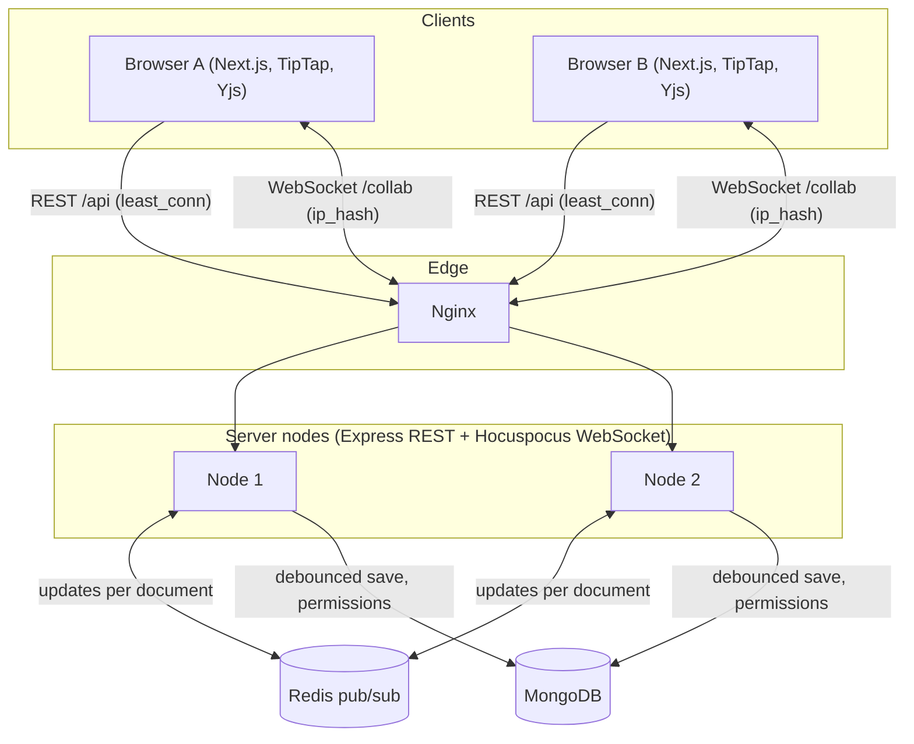

# KagazAi

[](https://github.com/HarshMishra2803/KagazAi/actions/workflows/ci.yml)

A real-time collaborative document editor for students and small teams. Several people edit the same document at once, offline edits merge when they reconnect, and every permission is enforced on the server.

**Live demo:** [kagazai.onrender.com](https://kagazai.onrender.com/)
The demo runs on Render, so the first request after a quiet period can take a while to wake the instance.

KagazAi is a learning and portfolio project. It is not a replacement for Google Docs. I built it to understand what happens underneath a collaborative editor: concurrent edits, offline merge, server-side access control, and scaling WebSockets across more than one server.

---

## Try it in two minutes

1. Open the [live demo](https://kagazai.onrender.com/) and create an account.
2. Create a document and type something.
3. In a private window, create a second account. From the first account, share the document with the second account's email as **Editor**.
4. Type in both windows. Each window shows the other person's cursor, selection, and name.
5. Change the second account to **Viewer**. That account can no longer edit, even if it tampers with the page in browser dev tools.
6. Save a named version, edit the document, then restore the version. Both windows update without a reload.
7. Select some text and add a comment. Reply to it and resolve the thread.

---

## Features

**Editing**
- Rich text: headings (H1 to H3), bold, italic, bullet and numbered lists, code blocks, and links.
- Toolbar that follows the current selection.

**Collaboration**
- Real-time sync with Yjs CRDTs. Concurrent edits merge without a lock, and edits made offline merge on reconnect.
- Live cursors, text selections, and an avatar bar of who is in the document. Colors come from a hash of the user id, so a person keeps the same color everywhere.
- Inline comment threads with replies and resolve. Comments stay attached to the right words while other people edit.

**Sharing and security**
- Roles per document: Owner, Editor, Viewer. Owners can also enable link-based general access.
- Roles are enforced on the REST API and on the WebSocket connection. A viewer's update packets are dropped by the server.
- Passwords are hashed with bcrypt. Sessions use an `httpOnly` cookie.

**History**
- Automatic version snapshot at most every 10 minutes during editing, plus manual named versions.
- Read-only preview of any version.
- Restore applies the old content as a new edit on the live document, so connected users see it update in place. A safety snapshot is taken before every restore.

**Platform**
- Document dashboard with role badges.
- Multi-node scaling through Redis pub/sub, with an Nginx and Docker Compose setup for running two server nodes locally.
- Privacy policy and terms pages, favicon and web manifest.

---

## How it works



**Life of a keystroke**

1. TipTap applies the edit to the local Yjs document, which produces a small binary update.
2. The update goes over the WebSocket to the Hocuspocus server. The server merges it into the in-memory document and relays it to everyone else in that room.
3. With more than one node, the node publishes the update to a Redis channel for that document. Other nodes apply it and forward it to their own clients.
4. After a short pause in typing (2 seconds, with a 10 second ceiling), the server writes the full document state to MongoDB as a binary buffer, along with a plain-text copy for future search.

**How a WebSocket connection is authorized**

The browser cannot set an `Authorization` header on a WebSocket. So the client calls `GET /auth/ws-token` (authenticated by the session cookie) and receives a ticket that expires in 5 minutes and is only valid for WebSocket use. The ticket is sent during the handshake. The server looks up the user's role for that document: no access means the connection is rejected, a viewer gets a read-only connection, and an editor or owner gets a read-write connection.

---

## Key engineering decisions

| Decision | Why | Trade-off |
| :--- | :--- | :--- |
| Yjs CRDT instead of Operational Transformation | Edits can arrive in any order and still converge, which makes offline editing and multi-node scaling much simpler. The server mostly relays binary updates. | CRDTs keep metadata for deleted text, so long-lived documents grow over time. |
| Store the Yjs state as a binary buffer, not HTML or JSON | Rebuilding a document from HTML creates new client ids and clocks, which duplicates text when an offline client reconnects. | A binary field cannot be queried directly, so a separate `plainText` field is kept for search. |
| Short-lived WebSocket ticket | Keeps the session cookie `httpOnly` while still letting the WebSocket authenticate. | One extra HTTP request before connecting. |
| Read-only enforced by the server | Hiding buttons or setting `editable: false` is not security. The server drops update packets from viewers. | A database lookup during the WebSocket handshake. |
| Restore as a forward edit | Rolling the stored state back to an older version makes connected clients re-send their newer edits, which undoes the restore. A new edit gets newer clocks and wins. | The server clones the old content into the live document during a transaction. |
| Comments as marks inside the document | Character offsets drift as soon as someone types earlier in the document. A mark moves with the text it covers. | If the whole commented phrase is deleted, the thread stays in the sidebar until it is resolved. |
| Cursors in the awareness channel, not the document | Cursor moves are frequent and temporary. Saving them would bloat history and the database. | Presence is lost on server restart, which is the intended behavior. |
| Debounced writes to MongoDB | Many keystrokes become one write. | A hard crash could lose the last couple of seconds if no client is still connected to re-sync. |
| Redis pub/sub between nodes | Users of one document can be connected to different nodes. | Redis is a single point of failure unless Sentinel or Cluster is added. |
| 404 instead of 403 for documents you cannot access | Stops people from probing which document ids exist. | Slightly less specific errors while debugging. |

---

## Tech stack

| Layer | Technology |
| :--- | :--- |
| Frontend | Next.js 16 (App Router), React 19, TypeScript (strict), Tailwind CSS v4, Lucide icons |
| Editor | TipTap 3 on ProseMirror, with Yjs collaboration and cursor extensions |
| Real-time | Yjs, Hocuspocus (server and provider), Yjs awareness protocol |
| Backend | Node.js, Express, Zod validation, bcryptjs, JWT in `httpOnly` cookies |
| Database | MongoDB with Mongoose |
| Scaling | Redis pub/sub through the Hocuspocus Redis extension, Nginx load balancing |
| Testing | Grafana k6 (load), GitHub Actions (build and type check) |
| Deployment | Docker, Docker Compose, Render |

## Project structure

```text
apps/web              Next.js app: landing page, auth, dashboard, editor UI
apps/server           Express REST API and Hocuspocus WebSocket server
nginx/                Nginx config for the two-node setup
tests/load/           k6 load test
docker-compose.yml    MongoDB, Redis, two server nodes, Nginx
render.yaml           Render blueprint
.github/workflows/    CI
```

---

## Run it locally

**Requirements:** Node.js 20 or newer, npm 9 or newer, and MongoDB (local or Atlas). Redis is only needed to run more than one server node.

```bash
npm install

cp apps/server/.env.example apps/server/.env
cp apps/web/.env.example apps/web/.env.local
```

Set these in `apps/server/.env`:

```env
PORT=5001
HOCUSPOCUS_PORT=1234
MONGODB_URI=mongodb://localhost:27017/kagazai
CLIENT_URL=http://localhost:3000
JWT_SECRET=a_random_string_of_at_least_32_characters
# Optional, only for multi-node:
REDIS_HOST=127.0.0.1
REDIS_PORT=6379
```

```bash
npm run dev
```

| Service | URL |
| :--- | :--- |
| Web app | http://localhost:3000 |
| REST API | http://localhost:5001 |
| Health check | http://localhost:5001/health |
| WebSocket | ws://localhost:1234 |

**Two server nodes with Nginx, Redis, and MongoDB:**

```bash
docker compose up -d --build
```

## Deploying

The live demo runs on Render as a single service: Express acts as the public gateway, serves the REST API and the WebSocket on the same port, and proxies page requests to Next.js. Everything shares one origin.

`render.yaml` also describes a split setup with separate backend, frontend, and Redis services. In that setup the frontend and backend live on different subdomains, so production cookies use `SameSite=None; Secure`.

Required environment variables: `MONGODB_URI`, `JWT_SECRET`, `CLIENT_URL`, and `REDIS_HOST` with `REDIS_PORT` when running more than one node.

---

## Security model

| Action | Owner | Editor | Viewer | No access |
| :--- | :--- | :--- | :--- | :--- |
| Open the document | Yes | Yes | Yes | 404 |
| WebSocket connection | Read and write | Read and write | Read only | Rejected |
| Edit content | Yes | Yes | Dropped by the server | No |
| Rename | Yes | Yes | 403 | 404 |
| Comment | Yes | Yes | 403 | 404 |
| Invite, change role, remove access | Yes | 403 | 403 | 404 |
| Delete the document | Yes | 403 | 403 | 404 |

---

## Load test

The k6 script in `tests/load/k6-collab.js` registers a user, creates a document, gets a WebSocket ticket, and then opens N WebSocket clients on the same document, each sending small updates.

**Machine:** Apple MacBook Air, 10-core Apple Silicon, 16 GB RAM, with MongoDB and Redis running locally. One server node. 15 seconds per run.

| Metric | 10 clients | 50 clients | 100 clients |
| :--- | :--- | :--- | :--- |
| WebSocket connections | 50 | 250 | 500 |
| Failed connections | 0 | 0 | 0 |
| Connection time, average | 1.54 ms | 1.24 ms | 1.58 ms |
| Connection time, p95 | 3 ms | 4 ms | 9 ms |
| Connection time, max | 4 ms | 6 ms | 12 ms |
| Auth and document setup, p95 | 109.89 ms | 107.98 ms | 108.15 ms |
| Message throughput | 6.55 per second | 32.68 per second | 65.25 per second |

**How to read these numbers**

- They measure WebSocket connection time and message throughput on localhost. They do not measure how long an edit takes to appear on another person's screen.
- Each client sends roughly 0.65 messages per second, so this is a light, human-paced load, not a stress test. The goal was to check that 100 clients in one room connect and stay connected on one node.
- The limits of the system were not found. Finding them (higher rates, more clients, multiple nodes, a remote server) is the next test to run.

To reproduce:

```bash
k6 run -e VUS=100 -e DURATION=15s tests/load/k6-collab.js
```

## Testing and CI

GitHub Actions builds the whole monorepo and type checks it on every push. The load test above is run by hand.

---

## Known limitations

1. **Live demo is one instance.** Multi-node scaling is available through Docker Compose and the Render blueprint, and was checked locally with two nodes (edits and cursors crossed between nodes, and one node was stopped mid-edit without data loss). The public demo does not run two nodes.
2. **Redis is a single point of failure.** If Redis stops, each node keeps serving its own clients, but nodes stop syncing with each other until it returns. High availability needs Redis Sentinel or Cluster.
3. **Load test scope.** One machine, one node, localhost, light message rate, and connection time rather than end-to-end edit latency.
4. **Comment ranges.** A comment attaches to a continuous run of text and cannot span block boundaries, for example from a paragraph into a list item.
5. **History growth.** Yjs keeps metadata for deleted text. Documents edited heavily for months would need periodic compaction.
6. **Latency across regions.** Collaborators far from the server and Redis see higher latency. Multi-region deployment is not implemented.

---

## Author

Built by Harsh ([@HarshMishra2803](https://github.com/HarshMishra2803)).
