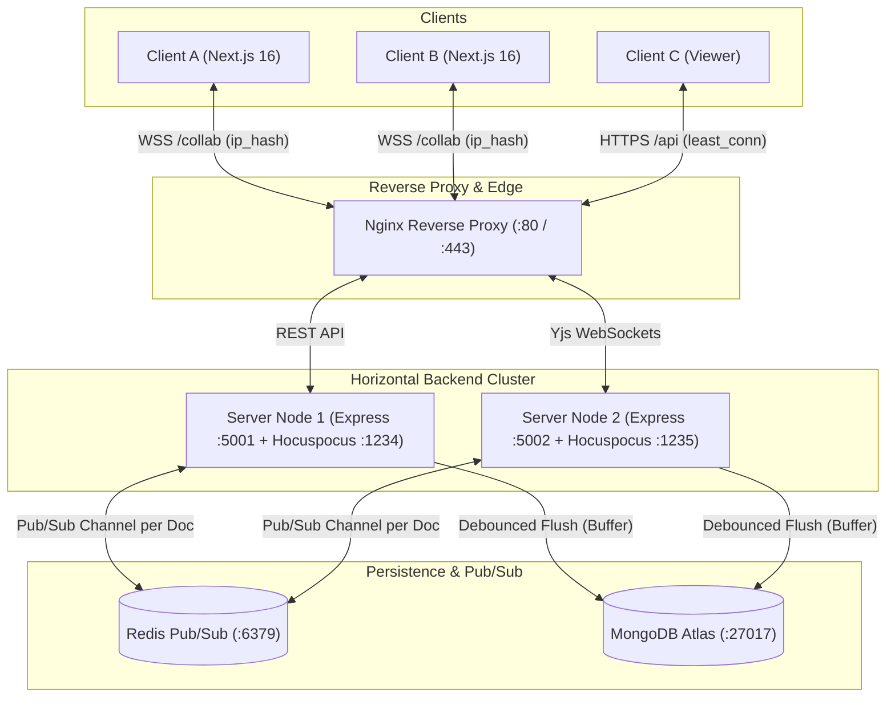

# KagazAi

KagazAi is a real-time collaborative document editor for students and small teams who write notes, assignments, and reports together. It synchronizes text edits using conflict-free replicated data types (CRDTs) over WebSockets, renders live presence with deterministic user cursors, provides granular role-based sharing permissions, captures automated version history snapshots, and scales horizontally across multiple backend instances via Redis pub/sub.

**Production Deployment & Setup**: [DEPLOYMENT.md](DEPLOYMENT.md) | **60-Second Demo Script**: [DEMO.md](DEMO.md) | **Load Test Report**: [LOADTEST.md](LOADTEST.md)

---

## Architecture Overview



---

## Tech Stack

| Layer | Technology | Purpose |
| :--- | :--- | :--- |
| **Frontend** | Next.js 16 (App Router, React 19) | Server components, static routing, and client application shell. |
| **Language** | TypeScript (Strict Mode) | End-to-end type safety across client and server. |
| **Rich-Text Editor** | TipTap 3 + ProseMirror | Document model, custom node schemas, and mark decorations. |
| **Styling** | Tailwind CSS v4 + Lucide Icons | Accessible neutral design system, 4-8px radius, WCAG AA contrast. |
| **Real-time Protocol** | Yjs + `@hocuspocus/provider` | Binary CRDT synchronization and awareness state over WebSockets. |
| **Backend Server** | Node.js + Express 4 + Hocuspocus 4 | REST authentication, permissions middleware, and Yjs WebSocket server. |
| **Database** | MongoDB Atlas + Mongoose 8 | Document metadata, binary CRDT state buffers, and version history. |
| **Horizontal Scaling** | Redis 8 + `@hocuspocus/extension-redis` | Cross-instance WebSocket update broadcasting via pub/sub. |
| **Load Balancer** | Nginx | Reverse proxy with hybrid `least_conn` (REST) and `ip_hash` (WebSockets). |
| **Performance Testing** | Grafana k6 (v2.3.0) | High-concurrency WebSocket load testing and latency measurement. |
| **Infrastructure** | Docker + Docker Compose | Multi-container orchestration for local and production deployment. |

---

## Core Features

- **Authentication & Sessions**: Password hashing using bcrypt with 10 salt rounds, signed JWTs stored in secure `httpOnly` sameSite cookies, and Zod input validation.
- **Document Management**: Dashboard with document creation, renaming, deletion, role badges, and MongoDB indexing on `{ ownerId: 1, updatedAt: -1 }`.
- **Rich-Text Editing**: Headings (H1 to H3), bold, italic, bullet lists, ordered lists, code blocks, links, and selection-aware toolbar.
- **Real-Time Collaboration**: Peer synchronization via Yjs CRDTs. Concurrent keystrokes merge deterministically without central lock bottlenecks.
- **Live Presence & Cursors**: Ephemeral cursor positions, text selection ranges, initials avatars, and deterministic color assignment derived from user identifiers.
- **Role-Based Sharing (RBAC)**: Fine-grained roles (Owner, Editor, Viewer). Server-enforced read-only mode in Hocuspocus socket hooks and Express route middleware.
- **Version History & Live Restore**: Automated snapshots every 10 minutes, manual named milestones, read-only preview, and forward-delta restore applied to the active in-memory document.
- **Inline Comment Threads**: Text range annotations using ProseMirror marks (`commentId`), threaded replies, and resolve states that preserve position when preceding text shifts.
- **Horizontal Multi-Node Scaling**: Real-time Redis pub/sub extension enabling users connected to separate server instances to edit the same room seamlessly.

---

## Design Decisions & Trade-offs

### 1. Conflict-Free Replicated Data Types (CRDTs) vs. Operational Transformation (OT)
- **Choice**: Yjs CRDT.
- **Rationale**: Operational Transformation (used in early Google Docs) requires every single keystroke to pass through a centralized sequencer to transform character offsets against concurrent operations. If the central sequencer lags or drops, client states diverge. Yjs uses mathematically commutative CRDT operations where edits can arrive out of order and converge to the identical state on all peers.
- **Trade-off**: CRDTs store tombstones (metadata for deleted characters) to calculate relative positioning, requiring slightly more memory than plain strings. Yjs mitigates this with compact run-length binary encoding, yielding sub-millisecond merges.

### 2. Binary State Buffer Storage in MongoDB vs. Relational/JSON Strings
- **Choice**: MongoDB storing the Yjs state vector as a binary `Buffer` alongside an unformatted `plainText` string.
- **Rationale**: Storing raw HTML or JSON after every keystroke requires constant schema conversion and loses the internal Lamport timestamps and client IDs needed for collaborative merging. Persisting the raw binary Y.Doc update (`Y.encodeStateAsUpdate`) allows instantaneous zero-copy hydration into memory when a document room opens.
- **Trade-off**: Binary buffers cannot be queried with arbitrary SQL `WHERE` clauses. To enable fast text search, we maintain a secondary `plainText` string updated during debounced database flushes.

### 3. Server-Enforced Security vs. Frontend Authorization
- **Choice**: All access controls (Owner, Editor, Viewer) are enforced strictly on the server.
- **Rationale**: The client UI is never trusted. While the frontend disables editing controls (`editable: false`), a malicious client can open DevTools or a raw WebSocket script to inject arbitrary binary update packets.
- **Implementation**: The Hocuspocus `onAuthenticate` hook queries MongoDB to verify document permissions. For users with the `viewer` role, the server sets `connectionConfig.readOnly = true`, which causes the socket layer to silently drop all incoming update frames at the protocol boundary.

### 4. Horizontal Scaling with Redis Pub/Sub and Nginx
- **Choice**: Redis pub/sub extension for Hocuspocus combined with hybrid Nginx load balancing.
- **Rationale**: When scaling to multiple server instances, User A on Node 1 and User B on Node 2 must collaborate on the same room. We use Redis channels keyed by document ID (`kagazai:collab:<docId>`). When Node 1 receives an edit, it publishes the update chunk to Redis; Node 2 receives the message and immediately broadcasts it to its connected clients.
- **Load Balancing Strategy**: Nginx distributes stateless REST API traffic using `least_conn` and persistent WebSocket traffic using `ip_hash` to keep client socket reconnections stable.

---

## Local Development Setup

### Prerequisites
- Node.js >= 18.0.0
- npm >= 9.0.0
- MongoDB (running locally on port 27017 or MongoDB Atlas connection URI)
- Redis (running locally on port 6379 or Docker container)

### Step 1: Install Dependencies
```bash
npm install
```

### Step 2: Configure Environment Variables

```bash
# Server configuration
cp apps/server/.env.example apps/server/.env

# Web configuration
cp apps/web/.env.example apps/web/.env.local
```

Ensure `apps/server/.env` contains your MongoDB and Redis connection parameters:
```env
PORT=5001
HOCUSPOCUS_PORT=1234
MONGODB_URI=mongodb://localhost:27017/kagazai
CLIENT_URL=http://localhost:3000
JWT_SECRET=your_jwt_secret_min_32_characters_long
REDIS_HOST=127.0.0.1
REDIS_PORT=6379
```

### Step 3: Run Development Servers
Start both backend API and frontend Next.js applications concurrently:
```bash
npm run dev
```

- Web Client: [http://localhost:3000](http://localhost:3000)
- Backend REST API: [http://localhost:5001](http://localhost:5001)
- Health Check: [http://localhost:5001/health](http://localhost:5001/health)
- Hocuspocus WebSocket: `ws://localhost:1234`

### Docker Compose Multi-Node Deployment
To run MongoDB, Redis, two balanced backend server nodes, and Nginx locally:
```bash
docker-compose up -d --build
```

---

## Empirical Load Test Results

KagazAi was benchmarked using Grafana k6 with WebSocket support (`tests/load/k6-collab.js`). Tests simulated concurrent clients in a single collaborative document room sending updates at realistic intervals.

**Test Machine**: Apple MacBook Air (10-Core Apple Silicon ARM64, 16 GB Unified RAM, macOS 27.0).

| Metric | 10 Concurrent Clients | 50 Concurrent Clients | 100 Concurrent Clients |
| :--- | :--- | :--- | :--- |
| **Duration** | 15 seconds | 15 seconds | 15 seconds |
| **Total Iterations** | 50 complete | 250 complete | 500 complete |
| **WebSocket Connections** | 50 (100% success) | 250 (100% success) | 500 (100% success) |
| **Failed Requests / Dropped Sockets** | 0 (0.00%) | 0 (0.00%) | 0 (0.00%) |
| **Connection Time (Average)** | 1.54 ms | 1.24 ms | 1.58 ms |
| **Connection Time (p50 / Median)** | 2.00 ms | 1.00 ms | 1.00 ms |
| **Connection Time (p90)** | 3.00 ms | 4.00 ms | 5.00 ms |
| **Connection Time (p95)** | 3.00 ms | 4.00 ms | 9.00 ms |
| **Connection Time (p99 / Max)** | 4.00 ms | 6.00 ms | 12.00 ms |
| **HTTP Auth & Doc Setup Duration (p95)** | 109.89 ms | 107.98 ms | 108.15 ms |
| **Throughput (Messages / Sec)** | 6.55 msgs/sec | 32.68 msgs/sec | 65.25 msgs/sec |
| **Data Transferred** | 42 kB | 192 kB | 379 kB |

*Note: For the complete methodology, execution parameters, and reproduction commands, review [LOADTEST.md](LOADTEST.md).*

---

## Known Limitations

1. **Redis Pub/Sub High Availability**: In the standard configuration, a single Redis instance coordinates cross-node pub/sub. If the Redis container stops, nodes continue serving their local clients but cross-instance synchronization pauses until reconnect. Production high availability requires Redis Sentinel or Redis Cluster.
2. **Comment Range Boundaries**: Inline comments attach to continuous text spans via ProseMirror marks. Comments do not span across block node boundaries (e.g. from an unformatted paragraph into a bullet list item).
3. **CRDT History Compaction**: Yjs maintains internal item metadata to resolve concurrent conflicts. Documents edited continuously for months with tens of thousands of character revisions will accumulate state vector size unless periodic history compaction is scheduled.
4. **Multi-Region Latency**: Real-time cross-region collaboration is bounded by speed-of-light latency to the primary Redis cluster. Global multi-region deployments would require geo-distributed Redis edge clustering.
